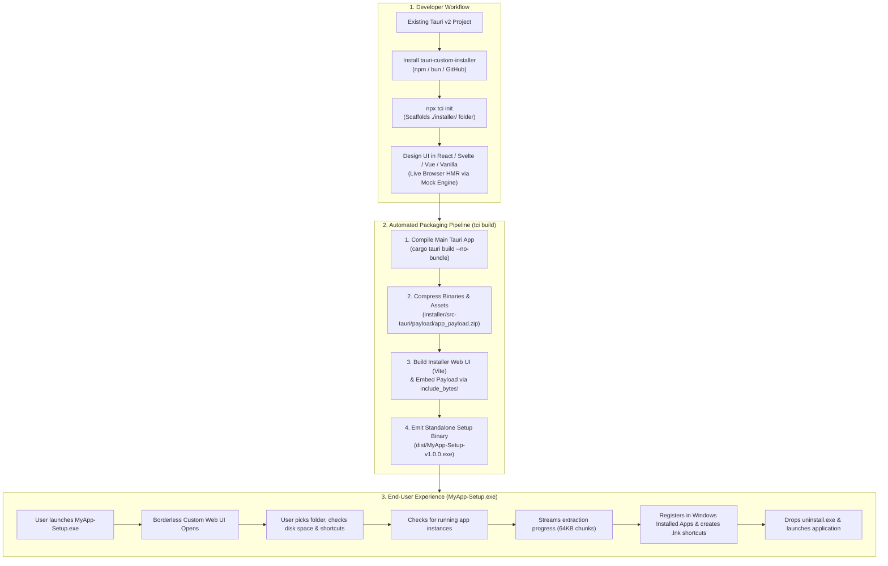

# Tauri Custom Installer (`tauri-custom-installer`)

<div align="center">

[](LICENSE)
[](https://v2.tauri.app/)
[](https://www.typescriptlang.org/)
[](https://www.rust-lang.org/)

**Build sleek, modern, web-based (React, Svelte, Vue, Vanilla HTML/CSS/TS) custom installers for Tauri v2 desktop applications.**  
Replace legacy 1990s Win32 NSIS wizards with a branded, frameless, animated setup experience written in your favorite frontend stack.

[Why Custom Installer?](#-why-tauri-custom-installer) • [Step-by-Step Integration Guide](#-step-by-step-integration-guide) • [Framework Examples](#-framework-code-examples) • [CLI Reference](#-cli-reference) • [API Reference](#-sdk--api-reference) • [CI/CD](#-github-actions-cicd)

</div>

---

## 💡 Why `tauri-custom-installer`?

When you run `tauri build` on Windows, Tauri generates traditional **NSIS** (`-setup.exe`) or **WiX** (`.msi`) installers:
- **Legacy UI Limitations**: NSIS relies on 1990s-era Win32 dialog boxes. Adding custom animations, glassmorphism, onboarding carousels, or interactive cards is nearly impossible.
- **Arcane Scripting**: Customizing NSIS requires learning `.nsi` macro scripting instead of HTML, CSS, and TypeScript.
- **Modern Expectations**: Applications like **Discord, Spotify, Steam, Battle.net, and VS Code** greet users with modern, branded, transparent setup wizards.

**`tauri-custom-installer`** solves this by adding a **first-class custom installer build target** alongside (or in place of) NSIS and MSI:

| Feature | Traditional NSIS / WiX | `tauri-custom-installer` |
| :--- | :--- | :--- |
| **UI Technology** | Win32 grey dialogs & bitmap banners | **HTML, CSS, Tailwind, React, Svelte, Vue, Vanilla TS** |
| **Developer Experience** | `.nsi` / XML scripting | **Standard Vite + HMR + Browser Simulation Mode** |
| **Rust Knowledge Needed** | N/A | **Zero** (all native OS calls are abstracted into JS hooks) |
| **Single-File Delivery** | Yes | **Yes** (`app_payload.zip` embedded via `include_bytes!`) |
| **User Consent & Safety** | Basic | **Full** (Folder picker, free disk check, running app guard) |
| **Windows Integration** | Registry + Shortcuts | **Add/Remove Programs Registry + `.lnk` Shortcuts + Startup** |
| **Clean Uninstaller** | Basic | **Two-stage self-deleting `%TEMP%` worker + UI** |
| **Silent Enterprise Install** | `/S` | **`/S`, `--silent`, `/D=C:\Path`, `--uninstall /S`** |

---

## 🏗️ How It Works (Architecture)



---

## 📖 Step-by-Step Integration Guide

Follow these steps to integrate `tauri-custom-installer` into **any new or existing Tauri v2 project**.

### Step 1: Install `tauri-custom-installer` in Your Project

Open a terminal in the **root directory of your Tauri v2 project** (where your main `package.json` and `src-tauri/` folder live).

#### Option A: Install via Package Manager (Bun / npm / pnpm)
```bash
# Using Bun
bun add -d tauri-custom-installer @tauri-custom-installer/client

# Using npm
npm install -D tauri-custom-installer @tauri-custom-installer/client

# Using pnpm
pnpm add -D tauri-custom-installer @tauri-custom-installer/client
```

#### Option B: Install Directly from GitHub Repository (No npm registry required)
If you are using the project directly from GitHub before or without npm publication:
```bash
# Clone the toolkit repository anywhere on your machine
git clone https://github.com/your-org/tauri-custom-installer.git
cd tauri-custom-installer
bun install && bun run build

# Then, inside your own Tauri v2 project root, run the CLI:
node /path/to/tauri-custom-installer/packages/cli/dist/index.js init
```
> **Note:** When initialized in an external project, `tci init` automatically vendors the Rust core crate (`tauri-custom-installer-core`) into `installer/src-tauri/core` and the TypeScript client SDK into `installer/.tci-sdk/client`. Your project builds **100% standalone and offline** without needing external private registries!

---

### Step 2: Initialize the Installer Workspace (`tci init`)

Run the initializer from your Tauri project root:

```bash
# Interactive mode (prompts you to pick React, Svelte, Vue, or Vanilla)
npx tci init

# Or specify your preferred frontend template directly:
npx tci init --template react
npx tci init --template svelte
npx tci init --template vue
npx tci init --template vanilla
```

#### What `tci init` automatically does in your project:
1. **Reads Your Main App Config**: Parses your `src-tauri/tauri.conf.json`, `src-tauri/Cargo.toml`, and `package.json` to detect your `productName`, `version`, `identifier`, `publisher`, and binary `executableName`.
2. **Creates the `./installer/` Directory**:
   ```text
   my-tauri-app/
   ├── src/                          # Your main application's frontend
   ├── src-tauri/                    # Your main application's Rust backend
   ├── installer/                    # ✨ NEW: Your Custom Installer Project
   │   ├── src/
   │   │   ├── installer.config.json # Auto-synced app metadata (Name, ID, Version, Exe)
   │   │   ├── App.tsx               # Multi-step Installer & Uninstaller UI
   │   │   └── components/           # Welcome, Options, Progress, Completed, Uninstall
   │   ├── src-tauri/
   │   │   ├── Cargo.toml            # Wired to tauri-custom-installer-core
   │   │   ├── build.rs              # Auto-manages payload/app_payload.zip
   │   │   ├── tauri.conf.json       # Borderless, transparent 680x450 setup window
   │   │   └── src/main.rs           # Embeds payload & registers IPC commands
   │   ├── package.json
   │   └── vite.config.ts
   └── package.json                  # Updated with "installer:dev" & "installer:build"
   ```
3. **Adds Helper Scripts to Your Root `package.json`**:
   ```json
   {
     "scripts": {
       "installer:dev": "tauri-custom-installer dev",
       "installer:build": "tauri-custom-installer build"
     }
   }
   ```
4. **Install Frontend Dependencies for the Installer**:
   ```bash
   cd installer
   bun install   # or: npm install
   cd ..
   ```

---

### Step 3: Design & Preview Your Installer UI (`tci dev`)

You develop your installer **exactly like a regular web frontend application**:

```bash
bun run installer:dev
# or: npm run installer:dev
```

- Opens `http://localhost:1421` (with Vite Hot Module Replacement).
- **Built-in Mock Simulation Engine**: When opened in a standard browser (Chrome, Edge, Firefox), `@tauri-custom-installer/client` automatically activates `MockInstallerDriver`:
  - Simulates `184 GB` of free disk space and default Windows paths (`C:\Users\Developer\AppData\Local\Programs\<AppName>`).
  - Simulates native folder browsing (`Browse...`).
  - Simulates realistic file extraction over 3–4 seconds with animated progress percentages and filenames.
  - Test the **Uninstaller UI** anytime in your browser by visiting:  
    `http://localhost:1421?mode=uninstall`

#### Customizing Metadata (`installer/src/installer.config.json`)
All templates read your app details from `installer/src/installer.config.json`:
```json
{
  "appName": "Sample Tauri App",
  "appId": "com.sample.tauriapp",
  "appVersion": "1.0.0",
  "publisher": "Tauri Community",
  "executableName": "sample-tauri-app.exe",
  "requiredBytes": 52428800
}
```
> During `tci build`, `requiredBytes` and `executableName` are automatically updated to match the exact uncompressed byte size and filename of your compiled release binaries.

---

### Step 4: Build the Standalone Setup Executable (`tci build`)

When you are ready to package your application for distribution, run:

```bash
bun run installer:build
# or: npm run installer:build
```

#### What `tci build` does under the hood:
1. **`[1/4] Compile Main App`**: Runs `cargo tauri build --no-bundle` (or `cargo build --release`) in your main project to produce the release `.exe`, `.dll`s, and resources. *(Tip: pass `tci build --skip-app-build` if you already compiled your main app).*
2. **`[2/4] Package Payload`**: Copies your main app's release binaries into a staging folder, calculates the exact uncompressed disk footprint, updates `installer.config.json`, and compresses everything with maximum zlib level-9 compression into `installer/src-tauri/payload/app_payload.zip`.
3. **`[3/4] Build Installer UI`**: Compiles your React / Svelte / Vue / Vanilla installer frontend into static assets via Vite.
4. **`[4/4] Compile Standalone Setup `.exe`**: Compiles `installer/src-tauri`, embedding `app_payload.zip` directly into the binary via `include_bytes!("../payload/app_payload.zip")`, and outputs your single-file setup wizard:
   ```text
   dist/<AppName>-Setup-v<Version>.exe
   ```

> **Using alongside NSIS / MSI**: Running `bun run tauri build` still produces Tauri's standard bundles in `src-tauri/target/release/bundle/`, while `bun run installer:build` produces your custom web-based setup executable in `dist/<AppName>-Setup-v<Version>.exe`.

---

### Step 5: Test Installation, Uninstallation & Silent Mode

1. **Interactive Setup**:
   Run `dist/<AppName>-Setup-v<Version>.exe`.
   - Choose Express Install (`Install Now`) or click `Advanced options` to pick a custom folder via the native Windows `Browse...` dialog, inspect available disk space, and toggle shortcuts.
   - If an older version of your app is currently running, the installer detects the process and politely prompts the user to close it before overwriting files.
2. **Windows Settings Integration**:
   Open **Windows Settings $\rightarrow$ Apps $\rightarrow$ Installed Apps**. Your app appears with its icon, version, publisher, install date, and estimated size.
3. **Interactive Uninstaller**:
   Clicking **Uninstall** in Windows Settings (or running `<InstallDir>\uninstall.exe`) automatically launches your custom **Uninstaller UI** (`isUninstallMode: true`). Upon confirmation, it closes running instances, removes shortcuts and registry entries, and spawns a temporary background worker in `%TEMP%` to delete the installation folder after `uninstall.exe` exits.
4. **Silent Enterprise CLI Mode**:
   IT administrators and package managers (e.g., Winget, Chocolatey) can install or uninstall silently without opening a window:
   ```powershell
   # Silent install to default directory (%LOCALAPPDATA%\Programs\<AppName>)
   .\MyApp-Setup-v1.0.0.exe /S

   # Silent install to a custom directory
   .\MyApp-Setup-v1.0.0.exe /S /D=C:\Apps\MyApp

   # Silent uninstall
   C:\Apps\MyApp\uninstall.exe --uninstall /S
   ```

---

## 💻 Framework Code Examples

### 1. React (`@tauri-custom-installer/client`)

```tsx
import { useInstaller } from '@tauri-custom-installer/client';
import installerConfig from './installer.config.json';

export function App() {
  const {
    step,                     // 'welcome' | 'options' | 'running_warning' | 'installing' | 'completed' | 'error'
    setStep,
    isUninstallMode,          // Automatically true when launched as uninstall.exe or --uninstall
    installPath,              // Default: C:\Users\<User>\AppData\Local\Programs\<AppName>
    setInstallPath,
    browseInstallPath,        // Opens native Windows Folder Picker dialog
    createDesktopShortcut,
    setCreateDesktopShortcut,
    createStartMenuShortcut,
    setCreateStartMenuShortcut,
    autoLaunchOnStartup,
    setAutoLaunchOnStartup,
    launchAfterInstall,
    setLaunchAfterInstall,
    validation,               // { is_valid, is_writable, has_enough_space, available_bytes, error_message }
    progress,                 // { stage, current_file, files_completed, total_files, percent }
    errorMessage,
    startInstall,             // Checks running processes & starts streaming extraction
    cancelInstall,            // Cancels extraction & rolls back partial files
    terminateRunningAndInstall,
    launchApp,                // Launches installed .exe and exits installer
    minimize,                 // Minimizes borderless installer window
    exit,                     // Closes installer window
  } = useInstaller(installerConfig);

  // Render your custom steps, animations, or Tailwind components!
}
```

### 2. Svelte 5 / Vue 3 / Vanilla TypeScript (`InstallerApi`)

If you are using Svelte, Vue, Solid, Ember, or Vanilla JS/TS, call `InstallerApi` directly:

```ts
import { InstallerApi } from '@tauri-custom-installer/client';
import installerConfig from './installer.config.json';

// 1. Query system info, default path, free disk space & uninstall mode
const sysInfo = await InstallerApi.getSystemInfo(
  installerConfig.appName,
  installerConfig.appId,
  installerConfig.requiredBytes
);

// 2. Open native folder picker dialog
const chosenFolder = await InstallerApi.selectFolder(sysInfo.default_install_path);

// 3. Validate any custom path
const check = await InstallerApi.validateInstallPath(
  chosenFolder || sysInfo.default_install_path,
  installerConfig.requiredBytes
);

// 4. Run streaming installation with real-time progress callback
await InstallerApi.startInstallation(
  {
    app_name: installerConfig.appName,
    app_id: installerConfig.appId,
    app_version: installerConfig.appVersion,
    publisher: installerConfig.publisher,
    executable_name: installerConfig.executableName,
    install_dir: chosenFolder || sysInfo.default_install_path,
    create_desktop_shortcut: true,
    create_start_menu_shortcut: true,
    auto_launch_on_startup: false,
    launch_after_install: true,
  },
  (progress) => {
    console.log(`${progress.percent}% - Extracting: ${progress.current_file}`);
  }
);

// 5. Launch installed app and close setup
await InstallerApi.launchInstalledApp(
  `${chosenFolder || sysInfo.default_install_path}\\${installerConfig.executableName}`
);
await InstallerApi.exitInstaller();
```

---

## 🧰 CLI Reference (`tci`)

| Command | Flags | Description |
| :--- | :--- | :--- |
| `tci init` | `-t, --template <react\|svelte\|vue\|vanilla>`<br/>`-n, --name <AppName>`<br/>`-f, --force` | Scaffolds the `./installer/` project, syncs app metadata into `installer.config.json`, and adds npm scripts. |
| `tci dev` | — | Starts the installer Vite dev server with Hot Module Replacement and browser simulation mode. |
| `tci build` | `--skip-app-build`<br/>`--no-release` | Compiles main app, compresses payload archive, embeds payload into installer, and outputs `dist/<AppName>-Setup-v<Version>.exe`. |
| `tci check` | — | Verifies local development tools (Node.js, Bun, Rust, Cargo, Tauri CLI). |

---

## 📚 SDK & API Reference

### `InstallerApi` Methods

| Method | Signature | Description |
| :--- | :--- | :--- |
| `getSystemInfo` | `(appName, appId, requiredBytes?) => Promise<SystemInfo>` | Returns default paths, free disk space, existing installation info, and `is_uninstall_mode`. |
| `validateInstallPath` | `(path, requiredBytes?) => Promise<PathValidation>` | Checks if the directory (or its parent) is writable and has sufficient free disk space. |
| `selectFolder` | `(initialPath?) => Promise<string \| null>` | Opens the native OS folder selection dialog. |
| `checkRunning` | `(executableName) => Promise<RunningProcessInfo>` | Detects if the target application is currently running and returns active PIDs. |
| `killRunning` | `(pids: number[]) => Promise<void>` | Gracefully (or forcefully) terminates running application instances. |
| `startInstallation` | `(options, onProgress) => Promise<void>` | Extracts embedded payload, creates `uninstall.exe`, generates `.lnk` shortcuts, and writes Registry keys. |
| `cancelInstallation` | `() => Promise<void>` | Aborts active extraction and cleans up partially written files. |
| `launchInstalledApp` | `(executablePath) => Promise<void>` | Spawns the installed application executable in its working directory. |
| `startUninstallation` | `(options, appName, exeName, onProgress) => Promise<void>` | Closes running instances, removes shortcuts & registry keys, and spawns the `%TEMP%` self-deleting file cleaner. |
| `minimizeInstaller` | `() => Promise<void>` | Minimizes the frameless installer window. |
| `exitInstaller` | `() => Promise<void>` | Closes the installer process with exit code `0`. |

---

## 🤖 GitHub Actions CI/CD

Automate building and publishing your custom setup `.exe` on every Git tag push by adding `.github/workflows/release-installer.yml` to your project:

```yaml
name: Release Custom Installer

on:
  push:
    tags:
      - 'v*'

permissions:
  contents: write

jobs:
  build-custom-installer:
    runs-on: windows-latest
    steps:
      - name: Checkout repository
        uses: actions/checkout@v4

      - name: Setup Bun
        uses: oven-sh/setup-bun@v2

      - name: Setup Rust Toolchain
        uses: dtolnay/rust-toolchain@stable
        with:
          targets: x86_64-pc-windows-msvc

      - name: Cache Rust Dependencies
        uses: Swatinem/rust-cache@v2

      - name: Install Dependencies
        run: |
          bun install
          cd installer && bun install

      - name: Build Standalone Custom Setup Executable
        run: bun run installer:build

      - name: Upload Setup Executable to GitHub Release
        uses: softprops/action-gh-release@v2
        with:
          files: dist/*-Setup-*.exe
        env:
          GITHUB_TOKEN: ${{ secrets.GITHUB_TOKEN }}
```

---

## 📂 Monorepo Structure & Documentation

- [`packages/core`](file:///c:/Users/kasim/Desktop/tauri-custom-installer/packages/core) — Rust crate (`tauri-custom-installer-core`) for Tauri v2.
- [`packages/client`](file:///c:/Users/kasim/Desktop/tauri-custom-installer/packages/client) — TypeScript Client SDK (`@tauri-custom-installer/client`) with React hooks & Mock driver.
- [`packages/cli`](file:///c:/Users/kasim/Desktop/tauri-custom-installer/packages/cli) — CLI toolkit (`tauri-custom-installer` / `tci`).
- [`templates/`](file:///c:/Users/kasim/Desktop/tauri-custom-installer/templates) — Ready-to-use templates for **React**, **Svelte 5**, **Vue 3**, and **Vanilla TS**.
- [`examples/sample-tauri-app`](file:///c:/Users/kasim/Desktop/tauri-custom-installer/examples/sample-tauri-app) — Complete demonstration Tauri v2 app with a custom React installer.
- [`docs/ARCHITECTURE.md`](file:///c:/Users/kasim/Desktop/tauri-custom-installer/docs/ARCHITECTURE.md) — Deep dive into streaming decompression, registry keys, and self-deleting workers.
- [`docs/INTEGRATION_GUIDE.md`](file:///c:/Users/kasim/Desktop/tauri-custom-installer/docs/INTEGRATION_GUIDE.md) — Quick integration checklist.
- [`docs/WINDOWS_REGISTRY.md`](file:///c:/Users/kasim/Desktop/tauri-custom-installer/docs/WINDOWS_REGISTRY.md) — Windows Registry (`Uninstall` & `Run`) specification.
- [`docs/CI_CD.md`](file:///c:/Users/kasim/Desktop/tauri-custom-installer/docs/CI_CD.md) — CI/CD and Windows Authenticode code-signing guide.

---

## 📄 License

MIT © Antigravity Team & Community.
