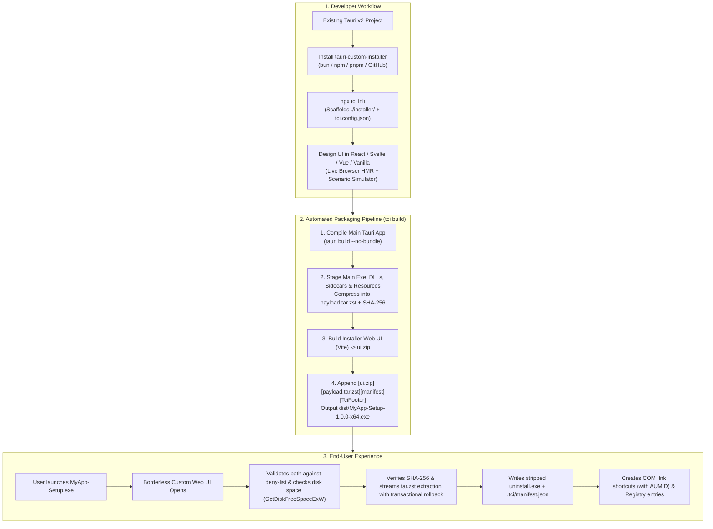

# Tauri Custom Installer with Tauri v2 (`tauri-custom-installer`)

<div align="center">

[](./LICENSE)
[](https://v2.tauri.app/)
[](https://www.typescriptlang.org/)
[](https://www.rust-lang.org/)

> [!NOTE]
> **100% AI-Developed:** This entire project, codebase, and architecture was authored and engineered completely by Artificial Intelligence, powered by **Gemini 3.8 Flash** and **Gemini 4 Argon**.

**Build a custom Tauri v2 installer *with Tauri v2 itself* using React, Svelte, Vue, Solid, or Vanilla HTML/CSS/TS.**  
Instead of writing legacy 1990s Win32 NSIS scripts or WiX XML, your setup wizard is **itself a lightweight, frameless Tauri v2 application** that extracts, registers, updates, and uninstalls your main Tauri v2 desktop app—with full NSIS/MSI feature parity, `tar.zst` streaming compression, and manifest-based security.

[Why Custom Installer?](#-why-tauri-custom-installer) • [Step-by-Step Integration Guide](#-step-by-step-integration-guide) • [Configuration (`tci.config.json`)](#-configuration-reference-tciconfigjson) • [Framework Examples](#-framework-code-examples) • [CLI & Enterprise Flags](#-cli--enterprise-flags-reference) • [Security Model](./SECURITY.md)

</div>

---

## 💡 Why `tauri-custom-installer`? (Tauri Installer Built with Tauri)

When you run `tauri build` on Windows, Tauri generates traditional **NSIS** (`-setup.exe`) or **WiX** (`.msi`) installers:
- **Legacy UI Limitations**: NSIS relies on 1990s-era Win32 dialog boxes. Adding custom animations, glassmorphism, onboarding carousels, or interactive cards is nearly impossible.
- **Arcane Scripting**: Customizing NSIS requires learning `.nsi` macro scripting instead of HTML, CSS, and TypeScript.
- **Modern Expectations**: Applications like **Discord, Spotify, Steam, Battle.net, and VS Code** greet users with modern, branded, transparent setup wizards.

**`tauri-custom-installer` solves this by letting you build your Tauri v2 installer *using Tauri v2 itself*:**
- Your installer UI is just a standard frontend project (**React, Svelte 5, Vue 3, Solid, Ember, or Vanilla HTML/CSS/TS**).
- Under the hood, a purpose-built **Tauri v2 Setup Runtime (`tci-runtime` + `tauri-custom-installer-core`)** renders your frameless web UI and executes all native Windows OS operations in Rust (`tar.zst` extraction, Win32 COM shortcuts with `AppUserModelID`, Registry registration, process management, and manifest-based uninstallation).

| Feature | Traditional NSIS / WiX | `tauri-custom-installer` (Tauri-in-Tauri) |
| :--- | :--- | :--- |
| **Installer Engine** | Win32 NSIS stub / MSI `msiexec` | **Tauri v2 Runtime (`tci-runtime`) + Rust Core (`tauri-custom-installer-core`)** |
| **UI Technology** | Win32 grey dialogs & bitmap banners | **React, Svelte 5, Vue 3, Solid, Ember, Vanilla HTML/CSS/TS** |
| **Developer Experience** | `.nsi` / XML scripting | **Vite HMR + Scenario Simulator + `--native` Dry-Run Sandbox** |
| **Compression & Streaming** | LZMA / Deflate | **`tar.zst` (Zstandard) & `.zip` with O(1) constant-memory `SectionReader` streaming** |
| **Uninstaller Footprint** | Separate stub | **Stripped `uninstall.exe` (keeps custom Tauri UI without duplicating app payload)** |
| **Safe Uninstallation** | Basic folder delete | **Manifest-tracked (`.tci/manifest.json`) — only deletes installed files, preserves user files, supports `purge_user_data`** |
| **Windows Integration** | Registry + Shortcuts | **Add/Remove Programs, `App Paths`, File Associations, Deep-Link URL Schemes, `System.AppUserModel.ID` (Toast Notifications)** |
| **Zero PowerShell Overhead** | N/A | **100% Native Win32 COM (`IShellLinkW`, `IPropertyStore`, `IFileOpenDialog`)** |
| **Enterprise Silent Mode** | `/S`, `/D=` | **`/S`, `/P`, `/UPDATE`, `/R`, `/D=<path>`, `/NS`, `/ALLOWDOWNGRADE`, `/LOG=<file>`** |

---

## 🏗️ How It Works (Appended SFX Architecture)

```text
MyApp-Setup-1.0.0-x64.exe = [ tci-runtime.exe ][ ui.zip ][ payload.tar.zst ][ manifest.json ][ TciFooter (136B, SHA-256) ]
```



---

## 📖 Step-by-Step Integration Guide

### Step 1: Install `tauri-custom-installer` in Your Tauri v2 Project

Open a terminal in the **root directory of your Tauri v2 project** (where your main `package.json` and `src-tauri/` folder live).

#### Option A: Install Directly from GitHub Repository (Recommended)
```bash
# Bun
bun add -d github:kmaksuut/tauri-custom-installer

# npm
npm install -D github:kmaksuut/tauri-custom-installer

# pnpm
pnpm add -D github:kmaksuut/tauri-custom-installer

# Yarn
yarn add -D github:kmaksuut/tauri-custom-installer
```

#### Option B: Install from npm Registry
```bash
# Bun
bun add -d tauri-custom-installer

# npm
npm install -D tauri-custom-installer
```

#### Option C: Clone & Run Locally
```bash
git clone https://github.com/kmaksuut/tauri-custom-installer.git
cd tauri-custom-installer
npm install && npm run build

# Inside your own Tauri v2 project root:
node /path/to/tauri-custom-installer/packages/cli/dist/index.js init
```
> **Note:** When initialized in an external project, `tci init` automatically vendors the client SDK into `installer/.tci-sdk/client` and the Rust core crate into `installer/src-tauri/core`, so your project builds **100% standalone and offline**!

---

### Step 2: Initialize the Installer (`tci init`)

Run the initializer from your Tauri project root:

```bash
# Interactive mode (prompts for framework and default install scope)
bunx tci init
# or: npx tci init

# Non-interactive mode with explicit flags:
npx tci init --template react --mode perUser --yes
npx tci init --template svelte
npx tci init --template vue
npx tci init --template vanilla
```

#### What `tci init` generates:
```text
my-tauri-app/
├── src/                          # Your main application's frontend (untouched)
├── src-tauri/                    # Your main application's Rust backend (untouched)
├── tci.config.json               # ✨ Single source of truth for installer settings
├── installer/                    # ✨ Your Custom Installer UI Project
│   ├── src/
│   │   ├── App.tsx               # Multi-step Installer & Uninstaller UI
│   │   └── components/           # Welcome, Options, Progress, Completed, Uninstall
│   ├── package.json
│   └── vite.config.ts
└── package.json                  # Updated with "installer:dev" & "installer:build"
```

Install the UI dependencies inside `installer/`:
```bash
cd installer && bun install && cd ..
# or with npm:
cd installer && npm install && cd ..
```

---

### Step 3: Design & Preview Your Installer UI (`tci dev`)

```bash
# Browser preview with Vite HMR & interactive scenario simulator
bun run installer:dev
# or: npm run installer:dev

# Native Tauri window in sandboxed dry-run mode (isolates registry under HKCU\Software\tci-sandbox)
npx tci dev --native
```

#### Testing Scenarios in the Browser Simulator:
Append `?scenario=<name>` to the dev server URL (`http://localhost:1421`) to design and test every UI state without writing mocks:
- `?scenario=success` — Standard installation flow
- `?scenario=already_installed_upgrade` — In-place upgrade flow (`v1.0.0` $\rightarrow$ `v1.2.0`)
- `?scenario=repair` — Same-version repair flow
- `?scenario=app_running` — Triggers the "Application is Currently Running" warning modal
- `?scenario=insufficient_space` — Simulates low disk space validation error
- `?scenario=permission_denied` — Simulates non-writable directory error
- `?scenario=corrupted_payload` — Simulates SHA-256 integrity failure
- `?mode=uninstall` — Opens the Uninstaller UI

---

### Step 4: Build the Standalone Setup Executable (`tci build`)

```bash
bun run installer:build
# or: npm run installer:build
```

Useful build flags:
```bash
npx tci build --skip-app-build   # Package existing release binaries without recompiling the main app
npx tci build --dry-run          # Inspect the exact list & sizes of staged payload files
npx tci build --arch arm64       # Build for Windows ARM64 (or x64 / x86)
npx tci build --no-sign          # Skip code signing
npx tci winget                   # Generate a WinGet YAML manifest with silent switches & SHA-256
```

---

## ⚙️ Configuration Reference (`tci.config.json`)

`tci` automatically inherits `productName`, `version`, `identifier`, `mainBinaryName`, `bundle.publisher`, `bundle.resources`, `bundle.externalBin`, `bundle.fileAssociations`, `plugins['deep-link']`, and `bundle.windows` signing settings from `src-tauri/tauri.conf.json`. You can override any setting in `tci.config.json`:

```json
{
  "productName": "Sample Tauri App",
  "identifier": "com.sample.tauriapp",
  "version": "1.0.0",
  "publisher": "Tauri Community",
  "ui": {
    "root": "./installer",
    "outDir": "./installer/dist"
  },
  "install": {
    "mode": "perUser",
    "allowDowngrade": false,
    "shortcuts": {
      "desktop": true,
      "startMenu": true,
      "startMenuFolder": "Sample Tauri App"
    },
    "autostart": "ask",
    "runAfterInstall": true,
    "addToPath": false
  },
  "compression": "zstd",
  "output": "./dist"
}
```

---

## 💻 Framework Code Examples

> **Zero React Dependency in Root Entry**: `@tauri-custom-installer/client` is 100% framework-agnostic. Framework hooks live in dedicated subpaths (`/react`, `/svelte`, `/vue`, `/solid`).

### 1. React (`@tauri-custom-installer/client/react`)

```tsx
import { useInstaller } from '@tauri-custom-installer/client/react';

export function App() {
  const {
    step,                     // 'welcome' | 'options' | 'running_warning' | 'installing' | 'completed' | 'error' | 'cancelled'
    action,                   // 'install' | 'upgrade' | 'repair' | 'downgrade'
    manifest,                 // Authoritative AppManifest embedded at build time
    isUninstallMode,          // True when launched as uninstall.exe or with --uninstall
    installPath,              // Default: %LOCALAPPDATA%\<AppName>
    setInstallPath,
    browseInstallPath,        // Native Win32 IFileOpenDialog (auto-appends \<AppName> on non-empty folders)
    validation,               // { is_valid, is_writable, has_enough_space, available_bytes, error_code, error_message }
    progress,                 // { stage, current_file, percent, speed_bps, eta_seconds }
    structuredError,          // { code, message, details }
    t,                        // Built-in localized strings (en, tr, de, fr, es, pt-BR, ru, zh-CN, ja, ko, ar)
    startInstall,
    cancelInstall,
    terminateRunningAndInstall,
    launchApp,
    minimize,
    exit,
  } = useInstaller();

  // Render your custom UI components
}
```

### 2. Svelte 5 (`@tauri-custom-installer/client/svelte`)

```ts
import { createSvelteInstaller } from '@tauri-custom-installer/client/svelte';

const installer = createSvelteInstaller();
// Use `$installer.step`, `$installer.progress`, `installer.startInstall()` in your .svelte component
```

### 3. Vue 3 / Solid / Ember / Vanilla TypeScript (`createInstallerStore`)

```ts
import { createInstallerStore } from '@tauri-custom-installer/client';

const store = createInstallerStore();
store.subscribe((state) => {
  console.log('Current step:', state.step, 'Progress:', state.progress.percent);
});
await store.init();
```

---

## 🖥️ CLI & Enterprise Flags Reference

### Developer CLI (`tci`)

| Command | Flags | Description |
| :--- | :--- | :--- |
| `tci init` | `-t, --template <react\|svelte\|vue\|vanilla>`<br/>`-m, --mode <perUser\|perMachine\|both>`<br/>`-y, --yes`, `-f, --force` | Scaffolds `./installer/`, generates `tci.config.json`, and configures scripts in `package.json`. |
| `tci dev` | `--native` | Starts Vite HMR dev server with mock simulator, or `--native` dry-run sandbox window. |
| `tci build` | `--skip-app-build`, `--debug`, `--arch <x64\|arm64\|x86>`, `--no-sign`, `--dry-run` | Stages main app & resources, compresses with `tar.zst`, and outputs `dist/<App>-Setup-<ver>-<arch>.exe`. |
| `tci winget` | `--url <url>`, `-o, --out <file>` | Generates a WinGet manifest YAML with silent switches and SHA-256 prefilled. |
| `tci check` | — | Verifies Node.js, Bun, Rust, Cargo, and Tauri CLI prerequisites. |

### End-User `Setup.exe` Command-Line Switches (NSIS & Updater Compatible)

| Switch | Description |
| :--- | :--- |
| `/S` or `--silent` | Fully silent installation (or uninstallation when combined with `--uninstall`). Requires no UI. |
| `/P` or `--passive` | Passive progress-only mode (automatically starts installation without prompts; used by updaters). |
| `/D=<path>` | Overrides target installation directory (supports unquoted spaces as the last argument on the command line). |
| `/UPDATE` | Update mode (reuses previous install directory and shortcut preferences from the registry). |
| `/R` or `--relaunch` | Automatically relaunches the application after installation completes. |
| `/NS` / `/NODESKTOP` | Suppresses all shortcuts (`/NS`) or desktop shortcut (`/NODESKTOP`). |
| `/ALLOWDOWNGRADE` | Permits installing an older version over a newer installed version. |
| `/LOG=<filepath>` | Writes detailed installation/uninstallation log output to `<filepath>`. |
| `/LANG=<locale>` | Overrides UI locale (`en`, `tr`, `de`, `fr`, `es`, `pt-BR`, `ru`, `zh-CN`, `ja`, `ko`, `ar`). |
| `--uninstall` | Runs in uninstaller mode. |

### Exit Codes

| Exit Code | Meaning |
| :--- | :--- |
| `0` | Success |
| `1` | Cancelled by user |
| `2` | Generic runtime or I/O error |
| `3` | Invalid/deny-listed target directory or insufficient disk space |
| `4` | WebView2 runtime missing or failed |
| `5` | Blocked by running process or downgrade policy |
| `6` | Payload SHA-256 integrity verification failed |
| `3010` | Success, system reboot required |

---

## 📂 Repository Structure & Documentation

- [`packages/core`](./packages/core) — Rust core crate (`tauri-custom-installer-core`) with Win32 COM shortcuts, `tar.zst` streaming, and manifest-based uninstaller.
- [`packages/runtime`](./packages/runtime) — Self-extracting Tauri v2 runtime stub (`tci-runtime`).
- [`packages/client`](./packages/client) — Framework-agnostic TypeScript Client SDK (`@tauri-custom-installer/client`) with `/react`, `/svelte`, `/vue`, `/solid` adapters.
- [`packages/cli`](./packages/cli) — CLI toolkit (`tauri-custom-installer` / `tci`).
- [`templates/`](./templates) — Production-ready UI templates for **React**, **Svelte 5**, **Vue 3**, and **Vanilla TS**.
- [`examples/sample-tauri-app`](./examples/sample-tauri-app) — Complete demonstration Tauri v2 application with custom installer.
- [`docs/ARCHITECTURE.md`](./docs/ARCHITECTURE.md) — Deep dive into the appended SFX binary layout, `tar.zst` streaming, and Win32 COM integration.
- [`docs/INTEGRATION_GUIDE.md`](./docs/INTEGRATION_GUIDE.md) — Quick integration checklist.
- [`docs/WINDOWS_REGISTRY.md`](./docs/WINDOWS_REGISTRY.md) — Windows Registry (`Uninstall`, `App Paths`, `Classes`, `Run`) specification.
- [`docs/CI_CD.md`](./docs/CI_CD.md) — GitHub Actions CI/CD and Authenticode signing guide.
- [`SECURITY.md`](./SECURITY.md) — Security architecture & IPC trust boundary specification.

---

## 📄 License

MIT © Tauri Custom Installer Contributors.
