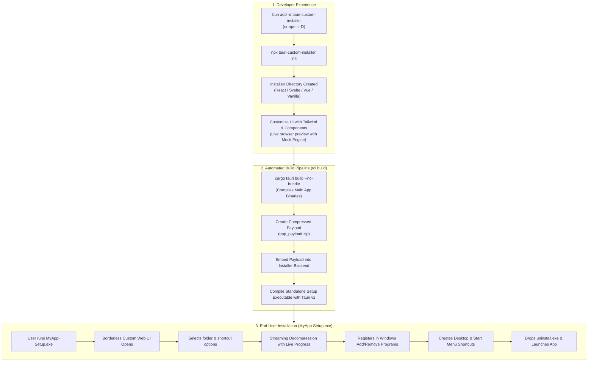

# Tauri Custom Installer (`tauri-custom-installer`)

<div align="center">

[](LICENSE)
[](https://v2.tauri.app/)
[](https://www.typescriptlang.org/)
[](https://www.rust-lang.org/)

**Create sleek, modern, web-based (React, Svelte, Vue, Vanilla HTML/CSS) custom installers for Tauri v2 desktop applications.**  
Say goodbye to outdated 1990s Win32 NSIS dialogues and build beautiful, branded installation experiences.

[Features](#-key-features) • [Quickstart](#-quickstart) • [Architecture](#-architecture) • [Templates](#-starter-templates) • [CLI Reference](#-cli-commands) • [Docs](#-documentation)

</div>

---

## 💡 Why `tauri-custom-installer`?

When building desktop applications with Tauri v2 on Windows, the default installer options are **NSIS** (`.exe`) and **WiX** (`.msi`):
- **NSIS** locks developers into 1990s-era Win32 wizard windows with rigid, clunky controls.
- Customizing NSIS requires learning an esoteric scripting language (`.nsi`) and fighting with Win32 UI limitations.
- Modern software (**Discord, Spotify, Steam, Battle.net**) delivers branded, borderless, animated, and delightful installer experiences.

**`tauri-custom-installer`** gives you a first-class custom installer target alongside (or replacing) traditional NSIS/MSI:
- 🎨 **Pure Frontend Developer Experience (DX)**: Build your installer **exactly like developing any standard web application** in React, Svelte, Vue, or Vanilla HTML/CSS using Vite, Tailwind CSS, and components. Zero Rust code required from the frontend developer!
- 🛡️ **Full User Transparency & Security**: Prompts the user with clear choices:
  - Custom target directory picker with real-time free disk space calculation.
  - Shortcut creation consent (Desktop, Start Menu).
  - Auto-start on Windows boot consent.
  - Active process detection: Politely asks the user before closing running instances to prevent file corruption.
- 🧹 **Clean Uninstaller Included**: Drops a dedicated `uninstall.exe`, registers in **Windows Settings $\rightarrow$ Installed Apps** (Add/Remove Programs), and cleanly purges all files, shortcuts, and registry keys without leaving orphan files.
- ⚡ **Mock Simulation Engine**: Design and test the entire installation wizard inside your browser with Vite Hot Module Replacement (HMR) without writing real files to disk.

---

## 🏗️ Architecture



---

## 🚀 Quickstart

### 1. Install in your existing Tauri v2 project

```bash
# Using bun
bun add -d tauri-custom-installer

# Using npm
npm install -D tauri-custom-installer

# Using pnpm
pnpm add -D tauri-custom-installer
```

### 2. Scaffold your custom installer UI

```bash
npx tauri-custom-installer init
```

You can choose your favorite frontend framework:
```bash
npx tauri-custom-installer init --template react    # Flagship React 19 + Tailwind CSS + Lucide
npx tauri-custom-installer init --template svelte   # Modern Svelte 5 template
npx tauri-custom-installer init --template vue      # Vue 3 + Tailwind template
npx tauri-custom-installer init --template vanilla  # Lightweight zero-dependency Vanilla TS
```

### 3. Develop & Style Your Installer (Live HMR)

```bash
bun run installer:dev
# or: npm run installer:dev
```
Open your browser or the live preview window. Style your installer with Tailwind CSS, test disk space validation, and preview progress animations using the built-in **Mock Simulation Engine**!

### 4. Build Standalone Setup Executable

```bash
bun run installer:build
# or: npm run installer:build
```
This produces your standalone, production-ready installer executable in:
`dist/<AppName>-Setup-v<Version>.exe`.

---

## 💻 Frontend Code Example (React)

```tsx
import { useInstaller } from '@tauri-custom-installer/client';

export function Installer() {
  const {
    step,                     // 'welcome' | 'options' | 'installing' | 'completed' | 'error'
    setStep,
    installPath,              // Defaults to %LOCALAPPDATA%\Programs\<AppName>
    setInstallPath,
    createDesktopShortcut,
    setCreateDesktopShortcut,
    createStartMenuShortcut,
    setCreateStartMenuShortcut,
    autoLaunchOnStartup,
    setAutoLaunchOnStartup,
    progress,                 // { percent, current_file, stage }
    validation,               // { is_valid, available_bytes, has_enough_space }
    startInstall,             // Initiates installation
    launchApp,                // Spawns application on finish
    exit,                     // Closes setup window
  } = useInstaller({
    appName: 'My Awesome App',
    appId: 'com.example.myapp',
    appVersion: '1.0.0',
    publisher: 'Antigravity Studio',
    executableName: 'my-app.exe',
    requiredBytes: 150 * 1024 * 1024, // 150 MB
  });

  return (
    <div className="w-[680px] h-[450px] bg-slate-900 rounded-2xl shadow-2xl p-6 text-white">
      {step === 'welcome' && (
        <button onClick={startInstall} className="btn-primary">
          Install Now
        </button>
      )}

      {step === 'installing' && (
        <div>
          <div className="progress-bar" style={{ width: `${progress.percent}%` }} />
          <p className="text-xs font-mono">{progress.current_file}</p>
        </div>
      )}

      {step === 'completed' && (
        <button onClick={launchApp} className="btn-primary">
          Launch Application
        </button>
      )}
    </div>
  );
}
```

---

## 🧰 CLI Commands

| Command | Description |
| :--- | :--- |
| `tci init [-t <template>]` | Scaffolds the `installer/` directory in your Tauri v2 project. |
| `tci dev` | Launches the installer Vite dev server with Hot Module Replacement and live preview. |
| `tci build` | Builds the main app, packages the payload archive, and compiles `<AppName>-Setup.exe`. |
| `tci check` | Validates local tooling prerequisites (Rust, Cargo, Bun, Node, Tauri CLI). |

---

## 📂 Monorepo Structure

```
tauri-custom-installer/
├── packages/
│   ├── core/              # Rust crate: tauri-custom-installer-core (Tauri v2 plugin)
│   ├── client/            # TypeScript SDK: @tauri-custom-installer/client (React hooks & mock)
│   └── cli/               # CLI executable: tauri-custom-installer (bin: tci)
├── templates/
│   ├── react/             # Flagship React 19 + Tailwind CSS + Lucide Icons template
│   ├── svelte/            # Svelte 5 template
│   ├── vue/               # Vue 3 template
│   └── vanilla/           # Pure HTML/CSS/TS template
├── examples/
│   └── sample-tauri-app/  # Complete sample Tauri v2 app demonstrating integration
└── docs/
    ├── ARCHITECTURE.md    # Technical deep dive into extraction, registry & self-delete
    ├── INTEGRATION_GUIDE.md# Step-by-step tutorial for existing apps
    ├── WINDOWS_REGISTRY.md# Windows Add/Remove Programs registry specifications
    └── CI_CD.md           # Production GitHub Actions release workflow
```

---

## 🧪 Verification & Testing

All crates and packages include automated test suites:

- **Rust Core Tests**:
  ```bash
  cargo test --package tauri-custom-installer-core
  ```
  *Verifies path validation, drive space logic, and streaming archive extraction.*

- **Client SDK Tests**:
  ```bash
  cd packages/client && bun test
  ```
  *Verifies mock simulation engine, event emission, and TypeScript interfaces.*

---

## 📄 License

MIT © Antigravity Team & Community.
