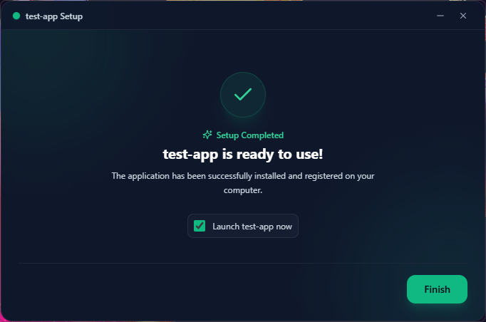

# Tauri Custom Installer (`tci`)

Build fast, customizable, web-powered **Windows Self-Extracting (SFX) installers** for **Tauri v2** applications—without NSIS, Inno Setup, or WebView bootstrapper bloat.

> [!NOTE]
> `tauri-custom-installer` replaces legacy script-based installers with a compact Tauri v2 SFX runtime stub (`tci-runtime.exe`), streaming `.tar.zst` / `.zip` decompression, native Win32 OS integration (zero PowerShell/shell-outs), release UI obfuscation, SHA-256 CTR SFX V2 armoring, and browser-based hot-reload previewing.

<p align="center">
  
  &nbsp;
  
</p>

---

## ⚡ The Mental Model: How It Works

Traditional installers run rigid 1990s scripts (NSIS) or download massive 100MB+ Chromium runtimes. `tauri-custom-installer` packages everything into **a single standalone `.exe`** with zero external dependencies:

```text
+-----------------------------------------------------------------------------------------+
|                                  YourApp-Setup.exe                                      |
+-----------------------------------------------------------------------------------------+
| [1] tci-runtime.exe (Lightweight Tauri v2 Rust executable stub)                         |
| [2] ui.zip          (Compiled Svelte/React/Vue/3D wizard — Encrypted via SHA-256 CTR)   |
| [3] payload archive (Compressed application files: .tar.zst or .zip)                    |
| [4] manifest.json   (Authoritative app metadata & registry hooks — SHA-256 CTR encrypted)|
| [5] 136-byte Footer (Byte offsets, payload SHA-256, UI SHA-256, V2 armor signature)     |
| [6] [Optional]      (Appended Authenticode PKCS#7 code signature from signtool)         |
+-----------------------------------------------------------------------------------------+
```

### What happens when the user double-clicks `YourApp-Setup.exe`?
1. **Instant Launch**: `tci-runtime.exe` starts immediately and scans its own binary backwards to read the 136-byte footer.
2. **In-Memory Decryption**: The UI bundle (`ui.zip`) is decrypted in memory using symmetric SHA-256 CTR stream ciphering bound to the binary digests.
3. **Embedded Custom Protocol**: The installer UI loads over `tci://localhost/` directly from RAM without touching the hard drive.
4. **Authoritative Trust Boundary**: Rust core enforces all security invariants. Malicious frontend IPC tampering cannot alter installation targets or registry keys.
5. **Streaming Zero-Copy Extraction**: Gigabytes of files decompress in streaming chunks ($O(1)$ RAM usage) with automatic transactional rollback on error.
6. **Zero Shell-Out Windows Integration**: Desktop shortcuts (`IShellLinkW`), directory dialogs (`IFileOpenDialog`), certificate store enrollment (`CryptoAPI`), and Add/Remove Programs registry entries execute natively without spawning `powershell.exe` or `cmd.exe`.
7. **Clean Uninstaller**: Writes `<install_dir>\uninstall.exe` without copying the payload, preserving the custom UI for seamless uninstallation and delayed self-deletion.

---

## 🎨 Pick Your UI Template

Run `init` inside your Tauri v2 project and pick the framework you love:

| Template | Alias(es) | Framework Stack | Features | Guide |
| --- | --- | --- | --- | --- |
| `react` *(default)* | — | React 19 + Tailwind CSS | Glassmorphism, Lucide Icons, `useInstaller` hook | [React Guide](./templates/react/README.md) |
| `futuristic-3d` | `3d`, `gaming`, `gaming-3d`, `three`, `threejs` | Three.js + WebGL + React | Interactive 3D core, procedural Web Audio SFX, fallback guard | [3D Guide](./templates/futuristic-3d/README.md) |
| `svelte` | — | **Svelte 5 Runes** (`$state`) | Ultra-light reactive wizard, minimal bundle size | [Svelte Guide](./templates/svelte/README.md) |
| `vue` | — | Vue 3 Composition API | `<script setup lang="ts">`, Vue reactivity | [Vue Guide](./templates/vue/README.md) |
| `vanilla` | — | Zero-Framework HTML/CSS/TS | Smallest possible binary footprint | [Vanilla Guide](./templates/vanilla/README.md) |

---

## 🚀 Step-by-Step: Adding to an Existing Tauri Project

`tauri-custom-installer` has first-class support for **Bun**, **npm**, **pnpm**, and **yarn**. Bun delivers sub-second scaffolding and bundling.

### Step 1: Scaffold Installer UI (Example: Svelte Template)

Run from your Tauri v2 project root:

```bash
# Using Bun:
bunx @tauri-custom-installer/cli init --template svelte

# Or using npx:
npx @tauri-custom-installer/cli init --template svelte

# Or choose any other template (react, futuristic-3d / 3d, vue, vanilla):
# bunx @tauri-custom-installer/cli init --template futuristic-3d
# bunx @tauri-custom-installer/cli init --template react
```

This command automatically:
- Creates an `./installer` folder with your chosen template.
- Generates `tci.config.json` in your project root.
- Adds `installer:dev` and `installer:build` helper scripts to your root `package.json`.
- Updates `.gitignore` to prevent secret leaks (`certs/`, `*.pfx`, `*.key`, `.tci/`).

### Step 2: Install Dependencies & Preview with Hot-Reload

```bash
# Navigate to installer directory and install dependencies:
cd installer
bun install      # or: npm install

# Start the Vite development server with mock API simulator:
bun run dev      # or: npm run dev
# (or from project root: bunx tci dev / npx tci dev)
```

Append query parameters in your browser URL to test every possible edge case:
- `http://localhost:5173/?scenario=success` — Normal clean install flow.
- `http://localhost:5173/?scenario=app_running` — App process currently running; tests PID killer prompt.
- `http://localhost:5173/?scenario=already_installed_upgrade` — Existing installation detected; upgrade flow.
- `http://localhost:5173/?scenario=insufficient_space` — Simulates disk space failure.
- `http://localhost:5173/?scenario=uninstall` — Previews the uninstaller view.

> [!TIP]
> **Native Windows Sandbox Mode**:
> To test the real native Windows window instead of the browser:
> ```bash
> bunx tci dev --tauri
> # or:
> npx tci dev --tauri
> ```
> This opens a native window in **Safe Sandbox Mode (`TCI_DRY_RUN=1`)** where registry writes are isolated under `HKCU\Software\tci-sandbox` without modifying system settings.

### Step 3: Build Standalone Windows Installer (`-Setup.exe`)

```bash
# Using Bun:
bunx tci build

# Using npm / npx:
npx tci build

# Or via package.json script:
bun run installer:build   # or: npm run installer:build
```

This compiles your Tauri app, obfuscates the frontend JavaScript, encrypts the SFX V2 sections, verifies certificates, and outputs your final installer to `target/tci/<AppName>-Setup.exe`.

---

## 🔐 Certificates & Code Signing: Complete Guide

There are **two completely different certificate workflows** in Windows installer development. Developers frequently confuse them, but `tauri-custom-installer` handles both natively with zero shell-outs and strict security boundaries:

```text
┌─────────────────────────────────────────────────────────────────────────────────────────┐
│ Workflow 1: Authenticode Code Signing (Signs the Setup.exe binary)                      │
│   • Purpose: Eliminates Windows SmartScreen warnings ("Unknown Publisher").            │
│   • Mechanism: Uses signtool.exe via tci.config.json `sign` configuration.              │
│   • Result: The output YourApp-Setup.exe carries an Authenticode PKCS#7 signature.      │
└─────────────────────────────────────────────────────────────────────────────────────────┘
┌─────────────────────────────────────────────────────────────────────────────────────────┘
│ Workflow 2: Windows Certificate Store Enrollment (Bundling & Installing CA certs)       │
│   • Purpose: Installs private Root CAs or publisher certificates on the user's PC.      │
│   • Mechanism: Native Win32 CryptoAPI via tci.config.json `certificates` array.         │
│   • Result: Target machine trusts your internal API, driver, or enterprise PKI.        │
└─────────────────────────────────────────────────────────────────────────────────────────┘
```

### Recommended Project Directory Structure

Store all certificate assets inside a dedicated `./certs` folder in your project root:

```text
my-tauri-app/
├── certs/
│   ├── codesign.pfx           # Code signing certificate (NEVER committed to git!)
│   ├── codesign.cer           # Public code signing certificate
│   └── enterprise-root-ca.cer # CA certificate to be installed into target Windows store
├── installer/                 # Svelte / React / Vue installer UI
├── src-tauri/                 # Tauri v2 backend
├── tci.config.json            # Authoritative configuration linking to ./certs
└── .gitignore                 # Automatically ignores certs/, *.pfx, *.key, etc.
```

> [!CAUTION]
> **Secret Hygiene**: `npx tci init` automatically adds `certs/`, `*.pfx`, `*.p12`, `*.key`, and `.tci/` to your `.gitignore`. Never commit private keys or `.pfx` files to version control!

---

### Workflow 1: Code Signing Your Installer (`Setup.exe`)

Code signing proves your application's authenticity and prevents Windows SmartScreen from displaying the blue *"Windows protected your PC / Unknown Publisher"* prompt.

#### Method A: Local Development & Testing (Self-Signed PFX)
1. **Verify `signtool.exe` availability:**
   ```bash
   npx @tauri-custom-installer/cli cert check
   ```
   *(Locates `signtool.exe` in Windows Kits 10/11 or Visual Studio tools automatically).*

2. **Generate a local test certificate and password:**
   ```bash
   npx @tauri-custom-installer/cli cert generate --out-dir ./certs --subject "My Dev Certificate"
   ```
   This generates `./certs/dev-cert.pfx` and `./certs/dev-cert.cer` and displays a temporary random password.

3. **Configure `tci.config.json`:**
   ```jsonc
   {
     "sign": {
       "pfxPath": "./certs/dev-cert.pfx",
       "passwordEnv": "TCI_PFX_PASSWORD", // Reads password safely from environment variable
       "timestampUrl": "http://timestamp.digicert.com"
     }
   }
   ```

4. **Set environment variable and build:**
   ```powershell
   # Windows PowerShell
   $env:TCI_PFX_PASSWORD = "your-password-here"
   npx @tauri-custom-installer/cli build
   ```

#### Method B: Production Signing with Hardware Token / Store Thumbprint (EV Cert)
If using an Extended Validation (EV) certificate, YubiKey, or Windows Certificate Store token:
```jsonc
{
  "sign": {
    "certificateThumbprint": "1a2b3c4d5e6f7a8b9c0d1e2f3a4b5c6d7e8f9a0b",
    "timestampUrl": "http://timestamp.digicert.com"
  }
}
```

#### Method C: GitHub Actions CI/CD Signing
In your CI/CD pipeline, encode your PFX file as a Base64 GitHub Secret (`CERT_PFX_BASE64`) and pass the password as `CERT_PASSWORD`:
```yaml
- name: Decode Code Signing Certificate
  shell: pwsh
  run: |
    [System.IO.File]::WriteAllBytes("./certs/codesign.pfx", [System.Convert]::FromBase64String("${{ secrets.CERT_PFX_BASE64 }}"))

- name: Build and Sign Installer
  shell: pwsh
  env:
    TCI_PFX_PASSWORD: ${{ secrets.CERT_PASSWORD }}
  run: npx @tauri-custom-installer/cli build
```

> [!NOTE]
> **Authenticode Coexistence Guarantee**: When `signtool.exe` signs the executable, it appends an Authenticode `WIN_CERTIFICATE` structure at the end of the PE file. `packages/core` features an Authenticode-tolerant footer scanner that scans backwards across the signature trailer, guaranteeing that code signing will **never** corrupt the SFX archive or payload integrity.

---

### Workflow 2: Bundling & Installing Certificates into the User's Windows Store

If your application requires target Windows machines to trust an internal CA, localhost HTTPS proxy certificate, or enterprise root certificate:

1. **Obtain your public certificate** (`.cer` or `.crt` in DER or PEM format). Place it in `./certs/my-root-ca.cer`.

2. **Inspect and verify its SHA-256 thumbprint:**
   ```bash
   npx @tauri-custom-installer/cli cert verify ./certs/my-root-ca.cer
   ```
   *Output example:*
   ```text
   ✔ Certificate verified: ./certs/my-root-ca.cer
     Subject: CN=Acme Internal Root CA, O=Acme Corp
     Format:  ASN.1 DER X.509
     SHA-256: e3b0c44298fc1c149afbf4c8996fb92427ae41e4649b934ca495991b7852b855
   ```

3. **Declare it in `tci.config.json`:**
   ```jsonc
   {
     "certificates": [
       {
         "path": "./certs/my-root-ca.cer",
         "store": "TrustedPublisher", // Options: "Root" | "TrustedPublisher" | "CA" | "My"
         "scope": "currentUser",      // "currentUser" (No UAC prompt) or "localMachine" (Requires Admin)
         "sha256Thumbprint": "e3b0c44298fc1c149afbf4c8996fb92427ae41e4649b934ca495991b7852b855"
       }
     ]
   }
   ```

#### How the Bundled Installation Works:
1. **At Build Time (`tci build`)**: The CLI parses the certificate, verifies that its SHA-256 digest matches `sha256Thumbprint`, stages it into `.tci/certs/`, and writes it into the encrypted SFX `manifest.json`.
2. **At Install Time (on the target PC)**: Rust core (`packages/core/src/certs.rs`):
   - Re-verifies the certificate's ASN.1 DER structure and pinned SHA-256 thumbprint.
   - Rejects any file path attempting path traversal (`..`) or NTFS junction/symlink escapes.
   - Enrolls the certificate directly via native Win32 CryptoAPI functions (`CertOpenStore` and `CertAddEncodedCertificateToStore`).
   - Spawns **zero** subprocesses (`powershell.exe` or `certutil.exe` are never used).
   - In dry-run mode (`TCI_DRY_RUN=1`), validation passes while system stores remain untouched.

---

## 🛠️ CLI Command Cheatsheet

| Command | Alias | What It Does |
| --- | --- | --- |
| `tci init` | — | Scaffold installer UI template, `tci.config.json`, and `.gitignore` rules |
| `tci dev` | — | Launch browser HMR simulator or native sandboxed window (`--tauri`) |
| `tci build` | — | Package single-file SFX V2 armored & signed Windows `-Setup.exe` |
| `tci cert check` | — | Locate Windows SDK `signtool.exe` |
| `tci cert generate` | — | Create local self-signed `.pfx` certificate for development |
| `tci cert verify <file>` | — | Parse certificate and output pinned SHA-256 thumbprint |
| `tci winget` | — | Generate WinGet submission YAML manifests (`winget-pkgs`) |
| `tci upgrade` | `update` | Synchronize client SDK and installer template to latest version |
| `tci clean` | — | Clean intermediate staging artifacts (`.tci/`, `.payload_staging/`) |
| `tci check` | `doctor` | Verify Rust toolchain, Tauri CLI, and signing prerequisites |

---

## ⚙️ Full Configuration Schema (`tci.config.json`)

```jsonc
{
  "appName": "Acme Studio",
  "appId": "com.acme.studio",
  "version": "1.0.0",
  "publisher": "Acme Software Inc.",
  "executableName": "acme-studio.exe",
  "uiRoot": "./installer",
  "installMode": "perUser", // "perUser" | "perMachine" | "both"
  "obfuscate": true,        // Strips sourcemaps, encodes JS strings, enables SFX V2 armor
  "certificates": [
    {
      "path": "./certs/root-ca.cer",
      "store": "TrustedPublisher",
      "scope": "currentUser",
      "sha256Thumbprint": "e3b0c44298fc1c149afbf4c8996fb92427ae41e4649b934ca495991b7852b855"
    }
  ],
  "sign": {
    "pfxPath": "./certs/codesign.pfx",
    "passwordEnv": "TCI_PFX_PASSWORD",
    "timestampUrl": "http://timestamp.digicert.com"
  }
}
```

---

## 📦 Monorepo Architecture

- [`packages/core`](./packages/core/README.md) (`tauri-custom-installer-core`): Rust SFX V1/V2 engine, `SectionReader`, `.tar.zst`/`.zip` transactional extractor, Win32 COM/CryptoAPI OS integration, Registry sandbox, and `tci://` protocol handler.
- [`packages/client`](./packages/client/README.md) (`@tauri-custom-installer/client`): Framework-agnostic SDK (`InstallerApi`, `createInstallerStore`, simulator driver, RTL/i18n) + React/Svelte/Vue/Solid bindings.
- [`packages/cli`](./packages/cli/README.md) (`@tauri-custom-installer/cli`): `tci` CLI for scaffolding, obfuscation, SFX V2 packaging, certificates, signing, and WinGet generation.
- [`packages/runtime`](./packages/runtime/Cargo.toml) (`tci-runtime`): Minimal Tauri v2 runtime executable embedded at the head of Single-File SFX binaries.
- [Architecture Deep-Dive](./docs/ARCHITECTURE.md) | [Integration Guide](./docs/INTEGRATION_GUIDE.md) | [Security Policy](./SECURITY.md) | [CI/CD Guide](./docs/CI_CD.md) | [Windows Registry Spec](./docs/WINDOWS_REGISTRY.md)

---

## 🧪 Repository Health & Orchestrator

Maintain repository hygiene, synchronize versions, and run audits across all packages:

```bash
# Run full clean, version sync, security/UI audits, and package test suites:
npm run orchestrate

# Individual orchestrator stages:
npm run orchestrate:clean
npm run orchestrate:sync
npm run orchestrate:audit
npm run orchestrate:audit:ui
npm run orchestrate:audit:diff
npm run orchestrate:verify
```

---

## 📄 License

MIT © [kmaksuut](https://github.com/kmaksuut)
