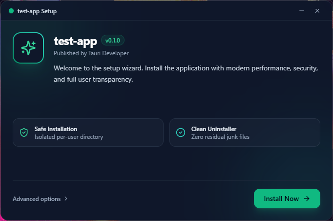

# Tauri Custom Installer (`tci`)

Build fast, customizable, web-powered **Windows Self-Extracting (SFX) installers** for **Tauri v2** applications—without NSIS, Inno Setup, or WebView bootstrapper bloat.

> [!NOTE]
> `tauri-custom-installer` replaces legacy script-based installers with a compact Tauri v2 SFX runtime stub (`tci-runtime.exe`), streaming `.tar.zst` / `.zip` decompression, native Win32 OS integration (zero PowerShell/shell-outs), release UI obfuscation, SHA-256 CTR SFX V2 armoring, and browser-based hot-reload previewing.

<p align="center">
  
  &nbsp;
  
</p>

## Why Tauri Custom Installer?

- **Custom Web UI**: Design your installer in **React**, **Three.js 3D**, **Svelte 5**, **Vue 3**, or **Vanilla TypeScript** with hot-reload browser simulation (`?scenario=success|app_running|already_installed_upgrade|insufficient_space|uninstall`).
- **Zero Shell-Out Windows Native Core**: Uses native Win32 COM (`IShellLinkW`, `IFileOpenDialog`), native CryptoAPI (`CertOpenStore`, `CertAddEncodedCertificateToStore`), Windows Registry ARP entries, and Win32 process detection without spawning PowerShell or `cmd.exe`.
- **Single-File SFX V2 Security Armor**: Release builds apply UI JS obfuscation (`obfuscator.ts`) and encrypt the appended `ui.zip` + authoritative `manifest.json` using SHA-256 CTR (`TCI_SFX_V2`) with Authenticode trailer coexistence.
- **Certificate Pinning & Signing**: Supports dev certificate generation (`tci cert`), PFX / thumbprint / custom `signTool` signing, RFC 3161 timestamps, and SHA-256 thumbprint-pinned root/publisher cert deployment.
- **Built-in Repository Orchestrator**: Permanent health & security automation (`npm run orchestrate`) across versions, audit checks, tests, and npm tarball hygiene.

## Pick Your UI Template

Run `init` inside your Tauri v2 project and select the template that matches your frontend stack:

| Template | Alias(es) | Highlights | Guide |
| --- | --- | --- | --- |
| `react` *(default)* | — | React 19, Tailwind CSS, Lucide Icons, `useInstaller` & `useUninstall` hooks | [React README](./templates/react/README.md) |
| `futuristic-3d` | `3d`, `gaming`, `gaming-3d`, `three`, `threejs`, `futuristic` | Interactive Three.js WebGL core + warp particles, fallback guard, procedural Web Audio SFX | [Futuristic 3D README](./templates/futuristic-3d/README.md) |
| `svelte` | — | Lightweight Svelte 5 `$state` runes wizard with minimal bundle size | [Svelte README](./templates/svelte/README.md) |
| `vue` | — | Vue 3 `<script setup lang="ts">` Composition API wizard | [Vue README](./templates/vue/README.md) |
| `vanilla` | — | Zero-framework HTML/CSS/TS wizard for the smallest `ui.zip` footprint | [Vanilla README](./templates/vanilla/README.md) |

## Quick Start

### 1. Initialize Installer UI

```bash
# Default React template
npx @tauri-custom-installer/cli init

# Interactive 3D Three.js sci-fi template
npx @tauri-custom-installer/cli init --template futuristic-3d
# (or shorthand: --template 3d)

# Svelte, Vue, or Vanilla TypeScript
npx @tauri-custom-installer/cli init --template svelte
npx @tauri-custom-installer/cli init --template vue
npx @tauri-custom-installer/cli init --template vanilla
```

During `init`, choose your default Windows installation scope:
- `perUser` — Installs to `%LOCALAPPDATA%` without UAC elevation prompts *(recommended)*
- `perMachine` — Installs to `Program Files` with UAC elevation
- `both` — Lets end users pick the scope inside the installer UI

### 2. Preview UI in Browser or Dry-Run Sandbox

```bash
# Instant Vite HMR preview with built-in mock scenarios
npx @tauri-custom-installer/cli dev
```

Append `?scenario=...` in the browser to preview every edge state:
- `?scenario=success`
- `?scenario=app_running`
- `?scenario=already_installed_upgrade`
- `?scenario=insufficient_space`
- `?scenario=uninstall`

### 3. Build Single-File Windows SFX (`-Setup.exe`)

```bash
npx @tauri-custom-installer/cli build
```

Release builds compile your Tauri app payload (`.tar.zst` or `.zip`), obfuscate the UI bundle, package V2 SHA-256 CTR armored SFX sections, verify/stage configured `.cer` files, sign with `signtool` if configured, and optionally emit WinGet YAML manifests.

## CLI Command Reference

| Command | Alias | Description |
| --- | --- | --- |
| `tci init` | — | Scaffold installer UI template & `tci.config.json` + `.gitignore` rules |
| `tci dev` | — | Start Vite HMR UI simulator or sandboxed native preview (`TCI_DRY_RUN=1`) |
| `tci build` | — | Compile payload + obfuscated UI + V2 armored & signed SFX `-Setup.exe` |
| `tci cert [check\|generate\|verify]` | — | Locate `signtool.exe`, generate dev certs, or inspect SHA-256 cert thumbprints |
| `tci winget` | — | Generate WinGet (`winget-pkgs`) submission YAML manifests |
| `tci upgrade` | `update` | Synchronize `@tauri-custom-installer/client` and template setup versions |
| `tci clean` | — | Remove `.tci/`, `.payload_staging/`, and temporary build artifacts |
| `tci check` | `doctor` | Check Rust toolchain, Tauri CLI, `signtool.exe`, and `tci.config.json` |

See the full [CLI Reference](./packages/cli/README.md) for all flags and `tci.config.json` signing/certificate schema options.

## Configuration (`tci.config.json`)

```jsonc
{
  "appName": "My App",
  "appId": "com.example.myapp",
  "version": "1.0.0",
  "publisher": "Example Corp",
  "executableName": "my-app.exe",
  "installMode": "perUser",
  "obfuscate": true,
  "certificates": [
    {
      "path": "./certs/publisher-ca.cer",
      "store": "TrustedPublisher",
      "scope": "currentUser",
      "sha256Thumbprint": "optional-64-hex-sha256"
    }
  ],
  "sign": {
    "pfxPath": "./certs/codesign.pfx",
    "passwordEnv": "TCI_PFX_PASSWORD",
    "timestampUrl": "http://timestamp.digicert.com"
  }
}
```

> [!IMPORTANT]
> Never commit `.pfx`, `.p12`, `.key`, `.key.pem`, or `.env` files. Pass signing secrets through environment variables such as `sign.passwordEnv` (`TCI_PFX_PASSWORD`).

## Monorepo Packages & Documentation

- [`packages/core`](./packages/core/README.md) (`tauri-custom-installer-core`): Rust SFX V1/V2 engine, `SectionReader`, `.tar.zst`/`.zip` transactional extractor, Win32 COM/CryptoAPI OS integration, Registry sandbox, and `tci://` protocol handler.
- [`packages/client`](./packages/client/README.md) (`@tauri-custom-installer/client`): Framework-agnostic SDK (`InstallerApi`, `createInstallerStore`, simulator driver, RTL/i18n) + React/Svelte/Vue/Solid bindings.
- [`packages/cli`](./packages/cli/README.md) (`@tauri-custom-installer/cli`): `tci` CLI for scaffolding, obfuscation, SFX V2 packaging, certificates, signing, and WinGet generation.
- [`packages/runtime`](./packages/runtime/Cargo.toml) (`tci-runtime`): Minimal Tauri v2 runtime executable embedded at the head of Single-File SFX binaries.
- [Architecture Overview](./docs/ARCHITECTURE.md) | [Integration Guide](./docs/INTEGRATION_GUIDE.md) | [Security Policy](./SECURITY.md) | [CI/CD Guide](./docs/CI_CD.md) | [Windows Registry Spec](./docs/WINDOWS_REGISTRY.md)

## Repository Development & Orchestration

```bash
# Run full cleanup, version sync, security/UI/secret audits, Rust/Client/CLI tests & tarball checks
npm run orchestrate

# Targeted orchestrator checks
npm run orchestrate:clean
npm run orchestrate:sync
npm run orchestrate:audit
npm run orchestrate:audit:ui
npm run orchestrate:audit:diff
npm run orchestrate:verify
```

## License

MIT © [kmaksuut](https://github.com/kmaksuut)
