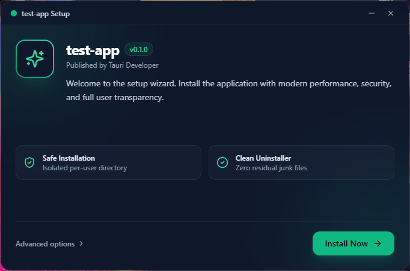
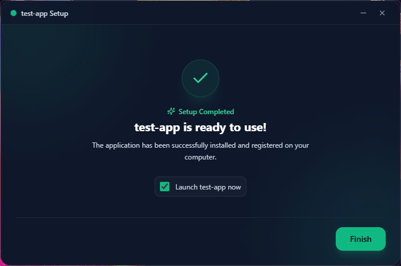

# Tauri Custom Installer (`tauri-custom-installer`)

<div align="center">

[](./LICENSE)
[](https://v2.tauri.app/)
[](https://www.typescriptlang.org/)
[](https://www.rust-lang.org/)

</div>

> [!NOTE]
> **100% AI-Developed:** This entire project, codebase, and architecture was authored and engineered completely by Artificial Intelligence, powered by **Gemini 3.8 Flash** and **Gemini 4 Argon**.

<div align="center">

**Build sleek, modern, web-based custom installers for Tauri v2 using Tauri v2 itself.**  
Replace outdated 1990s Win32 NSIS wizards with a frameless, animated setup experience written in **React, Svelte 5, Vue 3, Solid, or Vanilla HTML/CSS/TS**—with full NSIS/MSI feature parity, `tar.zst` streaming, and manifest-based safe uninstallation.

<br/>

<p align="center">
  
  
</p>

</div>

---

## ⚡ Quick Start (3 Steps)

### 1. Add to Your Tauri v2 Project

Inside your main Tauri project root (where `package.json` and `src-tauri/` reside):

```bash
# Using Bun (Recommended)
bun add -d tauri-custom-installer@github:kmaksuut/tauri-custom-installer

# Using npm
npm install -D tauri-custom-installer@github:kmaksuut/tauri-custom-installer
```

---

### 2. Choose Your UI Template & Initialize

Run the initializer and pick your preferred framework:

```bash
# Interactive selection:
bunx tci init

# Or pick your framework directly in one command:
bunx tci init --template react     # ⚛️ React 19 + Tailwind CSS + Lucide (Default)
bunx tci init --template svelte    # 🧡 Svelte 5 + TypeScript
bunx tci init --template vue       # 💚 Vue 3 + TypeScript
bunx tci init --template vanilla   # 🍦 Vanilla HTML / CSS / TypeScript
```

> **Note:** If an `installer/` directory already exists, append `--force` to re-initialize:  
> `bunx tci init --template svelte --force`

After initializing, install the UI dependencies:
```bash
cd installer && bun install && cd ..
# or: cd installer && npm install && cd ..
```

---

### 3. Develop & Build

```bash
# 1. Live UI Preview with HMR & 10-Scenario Simulator (No files modified)
bun run installer:dev

# 2. Build the Standalone Setup Executable (dist/<AppName>-Setup-1.0.0-x64.exe)
bun run installer:build
```

---

## 🎨 Templates & Customization Guide

All templates are production-ready out-of-the-box and automatically read your application name, version, publisher, and icons from `src-tauri/tauri.conf.json`. Customizing the UI is as simple as editing standard frontend code.

---

### ⚛️ React 19 (`--template react`)

- **Main File**: `installer/src/App.tsx`
- **Styling**: Tailwind CSS + Lucide Icons
- **SDK Import**: `@tauri-custom-installer/client/react`

```tsx
import { useInstaller } from '@tauri-custom-installer/client/react';

export function App() {
  const {
    step,                   // 'welcome' | 'options' | 'running_warning' | 'installing' | 'completed' | 'error'
    action,                 // 'install' | 'upgrade' | 'repair' | 'downgrade'
    installPath,            // Default: %LOCALAPPDATA%\<AppName>
    setInstallPath,
    browseInstallPath,      // Native Windows Explorer folder picker dialog
    createDesktopShortcut,
    setCreateDesktopShortcut,
    autoLaunchOnStartup,
    setAutoLaunchOnStartup,
    progress,               // { percent, current_file, speed_bps, eta_seconds }
    validation,             // { is_valid, has_enough_space, available_bytes }
    startInstall,
    launchApp,
    minimize,
    exit,
  } = useInstaller();

  return (
    <div className="w-[680px] h-[450px] bg-slate-900 text-white rounded-2xl ...">
      {/* Design your custom UI here */}
    </div>
  );
}
```

---

### 🧡 Svelte 5 (`--template svelte`)

- **Main File**: `installer/src/App.svelte`
- **Styling**: Scoped CSS / Modern Svelte 5 Runes
- **SDK Import**: `@tauri-custom-installer/client/svelte`

```svelte
<script lang="ts">
  import { createSvelteInstaller } from '@tauri-custom-installer/client/svelte';

  const installer = createSvelteInstaller();
</script>

<main class="installer-window">
  {#if $installer.step === 'welcome'}
    <h1>Welcome to {$installer.manifest.appName} Setup</h1>
    <button on:click={() => installer.setStep('options')}>Next</button>
  {:else if $installer.step === 'installing'}
    <div class="progress-bar" style="width: {$installer.progress.percent}%"></div>
  {/if}
</main>
```

---

### 💚 Vue 3 (`--template vue`)

- **Main File**: `installer/src/App.vue`
- **Styling**: Scoped CSS / Composition API
- **SDK Import**: `@tauri-custom-installer/client/vue`

```vue
<script setup lang="ts">
import { useInstaller } from '@tauri-custom-installer/client/vue';

const { step, manifest, progress, startInstall, selectFolder } = useInstaller();
</script>

<template>
  <div class="installer-card">
    <h2>Install {{ manifest.appName }} (v{{ manifest.version }})</h2>
    <button @click="startInstall">Install Now</button>
  </div>
</template>
```

---

### 🍦 Vanilla TypeScript (`--template vanilla`)

- **Main Files**: `installer/src/main.ts` & `installer/index.html`
- **SDK Import**: `@tauri-custom-installer/client`

```ts
import { createInstallerStore } from '@tauri-custom-installer/client';

const store = createInstallerStore();
store.subscribe((state) => {
  document.getElementById('status')!.textContent = `Status: ${state.step} (${state.progress.percent}%)`;
});
await store.init();
```

---

## ⚙️ Configuration Reference (`tci.config.json`)

The `tci.config.json` file in your project root is the single source of truth:

```json
{
  "productName": "My App",
  "identifier": "com.example.myapp",
  "version": "1.0.0",
  "publisher": "My Company",
  "install": {
    "mode": "perUser",
    "shortcuts": {
      "desktop": true,
      "startMenu": true,
      "startMenuFolder": "My App"
    },
    "autostart": "ask",
    "runAfterInstall": true,
    "addToPath": false
  },
  "compression": "zstd",
  "output": "./dist"
}
```

| Key | Default | Description |
| :--- | :--- | :--- |
| `install.mode` | `"perUser"` | `"perUser"` (%LOCALAPPDATA%, no UAC) or `"perMachine"` (Program Files, requires Admin). |
| `install.shortcuts.desktop` | `true` | Create desktop `.lnk` shortcut via native Win32 COM. |
| `install.shortcuts.startMenu` | `true` | Create Start Menu shortcut stamped with `AppUserModelID` for toast notifications. |
| `install.autostart` | `"ask"` | Autostart with Windows (`"ask"`, `"always"`, or `"never"`). |
| `compression` | `"zstd"` | Payload format: `"zstd"` (ultra-fast tar.zst) or `"zip"`. |
| `output` | `"./dist"` | Target directory for the final setup `.exe`. |

---

## 🧪 Browser Mock & Simulator

When developing your installer UI in browser mode (`bun run installer:dev`), you can test every edge case without modifying any system files by adding `?scenario=` to `http://localhost:1421`:

- `?scenario=success` — Normal installation flow
- `?scenario=already_installed_upgrade` — Upgrade flow from an existing version
- `?scenario=repair` — Re-install / repair flow
- `?scenario=app_running` — Triggers "Application is Currently Running" warning modal
- `?scenario=insufficient_space` — Simulates low disk space error
- `?scenario=permission_denied` — Simulates directory write permission error
- `?scenario=corrupted_payload` — Simulates SHA-256 integrity verification failure
- `?mode=uninstall` — Opens the Uninstaller view

---

## 🖥️ CLI Commands & End-User Switches

### Developer CLI (`tci`)
```bash
bunx tci init [-t react|svelte|vue|vanilla] [-y] [--force]
bun run installer:dev [--native]    # Dev preview (browser or dry-run sandboxed window)
bun run installer:build             # Build production Setup .exe
bunx tci winget                     # Generate WinGet YAML package manifest
```

### End-User Switches (NSIS & Silent Compatible)
The generated `dist/MyApp-Setup.exe` accepts standard switches:

| Switch | Description |
| :--- | :--- |
| `/S` | **Silent Mode**: Installs with zero UI, zero prompts, and exits with code `0`. |
| `/D=<path>` | Overrides target installation directory (e.g. `/D=C:\Tools\MyApp`). |
| `/P` | **Passive Mode**: Displays progress UI only without requiring user interaction. |
| `/UPDATE` | Upgrades existing installation while preserving user preferences. |
| `/R` | Relaunches application after installation finishes. |
| `/NS` | Suppresses shortcut creation. |
| `--uninstall` | Launches uninstallation mode. |

---

## 🔒 Security Architecture

- **Manifest-Driven Deletion**: Uninstallation deletes *only* files recorded in `.tci/manifest.json`. Never deletes entire user folders.
- **Dangerous Path Deny-List**: Rejects root drives (`C:\`), `%WINDIR%`, Desktop, and user profile roots in native Rust.
- **Zero PowerShell**: 100% native Win32 COM APIs (`IShellLinkW`, `IPropertyStore`, `IFileOpenDialog`) to avoid antivirus heuristics and execution policy blocks.
- **Streaming SHA-256 Verification**: Payload integrity is cryptographically verified before extraction.
- **Authenticode Compatible**: Supports digital code signing via `signtool` / `signCommand`.

---

## 📄 License

MIT © [kmaksuut](https://github.com/kmaksuut)