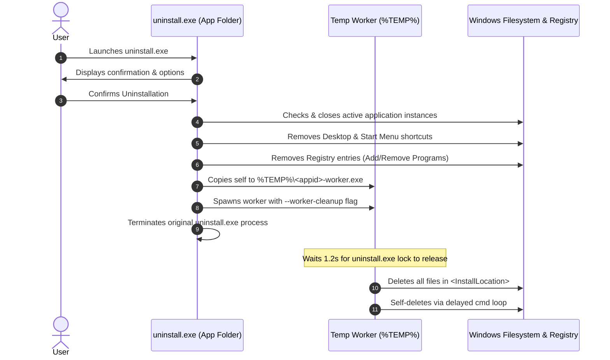

# Architecture & Technical Deep Dive

`tauri-custom-installer` enables desktop developers to build modern, animated, branded installer wizards for **Tauri v2** using Web technologies (**React, Svelte, Vue, Vanilla HTML/CSS/JS**) instead of outdated Win32 NSIS dialogues.

---

## 1. High-Level Concept

Traditional installers (NSIS/WiX) execute native scripts that render legacy Win32 user interfaces. In contrast, `tauri-custom-installer` uses Tauri itself as the installer execution engine:

1. **The Setup Executable (`MyApp-Setup.exe`)**:
   A borderless, fixed-dimension (680×450) Tauri v2 application.
2. **The Embedded Payload**:
   The compiled release files of the main desktop application are archived into an optimized `app_payload.zip` and bundled with the installer.
3. **The Core Engine (`tauri-custom-installer-core`)**:
   A Rust plugin handling high-speed archive extraction, chunk-by-chunk progress reporting, Windows Registry keys, Shell shortcuts, and safe process termination.
4. **The Client SDK (`@tauri-custom-installer/client`)**:
   A TypeScript abstraction with React hooks (`useInstaller`, `useUninstall`) and an in-browser Mock Simulation Engine.

---

## 2. Extraction Pipeline & Progress Streaming

```
[Embedded app_payload.zip] 
            │
            ▼
    [ZipArchive Reader]
            │
            ├─► Sanitize paths (Anti Zip-Slip protection)
            ├─► Stream decompression in 64 KB chunks
            │
            ▼
 [Destination Directory]
  (e.g., %LOCALAPPDATA%\Programs\MyApp)
            │
            ▼
 [Tauri IPC Channel] ──► Webview UI (Real-time percentage & file name)
```

The installer leverages Tauri v2's scoped `Channel<InstallProgress>` mechanism. Rather than flooding a global event bus, progress updates stream directly from the extraction thread to the webview:

- `stage`: `"extracting"` | `"creating_shortcuts"` | `"registering"` | `"finished"`
- `current_file`: File path currently being written
- `percent`: Calculated from uncompressed byte counts
- `bytes_extracted` vs `total_bytes`

---

## 3. Windows Integration & Add/Remove Programs

### 3.1 Registry Keys
To integrate seamlessly with **Windows Settings $\rightarrow$ Installed Apps** (Add/Remove Programs), the installer writes the following keys under `HKEY_CURRENT_USER\Software\Microsoft\Windows\CurrentVersion\Uninstall\<AppId>`:

| Key | Type | Value | Purpose |
| :--- | :--- | :--- | :--- |
| `DisplayName` | `REG_SZ` | `My Awesome App` | Application name displayed in Windows Settings |
| `DisplayVersion`| `REG_SZ` | `1.0.0` | Application version |
| `Publisher` | `REG_SZ` | `Developer Name` | Company or author name |
| `DisplayIcon` | `REG_SZ` | `C:\...\MyApp.exe,0` | Icon shown in Installed Apps |
| `InstallLocation`| `REG_SZ` | `C:\...\MyApp` | Installation directory |
| `UninstallString`| `REG_SZ` | `"C:\...\uninstall.exe"` | Command invoked when user clicks Uninstall |
| `QuietUninstallString`| `REG_SZ` | `"C:\...\uninstall.exe" /S`| Silent uninstallation command |
| `EstimatedSize`| `REG_DWORD`| Size in KB | Disk footprint reported to Windows |
| `NoModify` | `REG_DWORD`| `1` | Disables "Modify" button |
| `NoRepair` | `REG_DWORD`| `1` | Disables "Repair" button |

### 3.2 Auto-Start with Windows
If the user consents to launch the app on Windows startup, a registry value is added to:
`HKCU\Software\Microsoft\Windows\CurrentVersion\Run` $\rightarrow$ `"<ExecutablePath>"`.

### 3.3 Shell Shortcuts (.lnk)
Shortcuts are created using the Windows Shell COM engine (`IShellLinkW` / `WScript.Shell`):
- **Desktop**: `%USERPROFILE%\Desktop\<AppName>.lnk`
- **Start Menu**: `%APPDATA%\Microsoft\Windows\Start Menu\Programs\<AppName>.lnk`

---

## 4. Uninstallation Architecture & Self-Cleanup

On Windows, an executable file is locked by the OS kernel while running and **cannot delete itself**.

`tauri-custom-installer` solves this using a two-stage worker process:



---

## 5. Mock Simulation Engine for UI Design

To enable frontend designers and developers to iterate rapidly without performing real disk writes or having a compiled Rust backend running, `@tauri-custom-installer/client` detects if it is running inside a standard browser:

- In `vite dev`, the SDK automatically switches to `MockInstallerDriver`.
- Simulates realistic drive sizes (180+ GB available).
- Simulates file decompression over 3–5 seconds with animated file names.
- Emits shortcut and registry simulation events.
- Allows complete visual styling, dark/light theme adjustments, and interaction testing using standard browser DevTools and Vite HMR.
